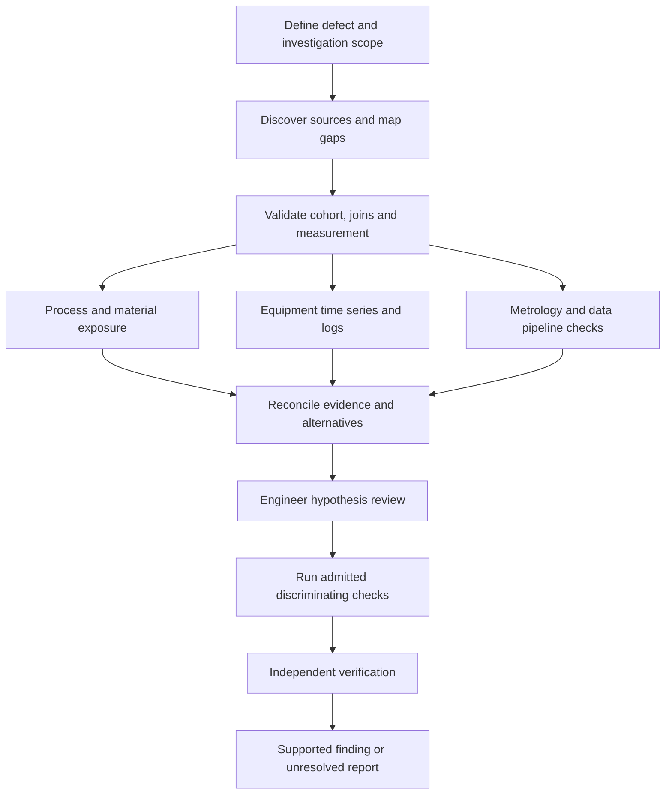

# ALG V1 Large Data Investigation Design Draft

Draft design for OpenCode ALG V1. Dated 9 November 2026.

ALG should turn a problem statement into a bounded, resumable investigation across a large, messy data estate. The initial domain profile is locating the source of a semiconductor defect or particle excursion using an approximately 11,000-table lake, process histories, time series, inspection data and logs. The deliverable is an evidence-supported explanation or an explicit unresolved result with the next discriminating test. Finding a plausible correlation is not sufficient closure.

This companion extends the [applicability and measured improvement design](alg-v1-applicability-measured-improvement-design.md). The existing four owner contracts, approval boundaries, experience stores and DAG executor remain authoritative. The first pilot uses a fixed authored graph. Hierarchical graph proposals and graph improvement follow later V1 increments. This is design work only; it starts no production queries, paid trials, implementation or V2 work.

The [design index](alg-v1-design-index.md) owns sequencing. The shared workspace registry and deployment qualification come first; this profile supplies the fixed investigation workflow after those foundations. V1 denotes the OpenCode 1 host.

## Division of responsibility

The user describes datalake-mcp as an existing FastMCP service with Polars, DuckDB, Arrow tables, Parquet in S3, preprocessing, merging and joining capabilities. It also exposes a multilayer knowledge map containing table metadata and inferred enrichment. That map is incomplete and can improve during use. Treat these as the integration starting point; exact tool schemas, permission enforcement, query limits, source versioning and job recovery guarantees still require adapter qualification.

| Owner | Responsibility |
| --- | --- |
| datalake-mcp | Data discovery, map lookup and supported enrichment, source access, query execution, preprocessing, analytical computation and result storage |
| ALG | Investigation objective, skills and checkpoints, work admission, hypotheses, evidence references, cumulative budgets, recovery and result synthesis |
| Existing source systems | Authoritative records, access controls, source-specific clocks, retention, schema and revision identities |
| Configured operator policy | Permitted resources, data egress, execution and map-update scopes, budgets, and publication or operational-change authority |

ALG does not duplicate the lake, introduce a second query engine or rebuild the MCP's knowledge map. It retains the small portion of the map needed for its decisions, with exact source references and coverage limits. Query optimization remains in the data service; ALG asks useful questions and checks whether returned evidence can answer them.

## Deployment qualification and data boundary

Before choosing the live adapter shape, inspect the actual datalake-mcp tools on the deployment host. Record tool schemas, existing job IDs and lookup/idempotency guarantees, enforced limits, result retention, source revisions and map-update behavior. Reuse an existing server job system; if an important guarantee is absent, evaluate the smallest server-side change rather than automatically building a second queue in ALG.

Create a deployment profile naming the actual model/runtime configuration, approved execution location and allowed data classes. Specify whether schemas, identifiers, aggregates, row values, logs, images and engineer notes may enter model context or telemetry. Aggregation is not automatic declassification. Apply approved projection, redaction and output limits at the service/adapter boundary before content enters the model or transcript. An unavailable policy or incompatible endpoint blocks that live path; the system can still work with synthetic fixtures.

Run one bounded, separately authorized pilot using synthetic or approved de-identified data and the model used in that environment. Check tool selection, structured output, adherence to procedures and honest uncertainty before large-scale implementation or effectiveness claims. This is an integration probe, not evidence that the model can find physical causes reliably. Record capabilities as deployment facts; do not branch ALG logic on model brand. Existing tests on other models do not qualify this deployment. If the air-gapped service cannot be accessed here, prepare an operator-runnable probe and retain deployment status as unverified.

## Three linked views of the investigation

Keep three distinct views with stable references between them:

1. The environment map describes datasets, fields, equipment, APIs, terminology, joins and lineage. Each relationship retains its origin, verification status, scope and revision.
2. The hypothesis and evidence view records suspected causes, predictions, observations, competing explanations and contradictions. A suspected causal edge is not promoted into an established environment fact merely because several agents repeat it.
3. The execution DAG records admitted work, dependencies, attempts, jobs, checkpoints and budgets. A coordinator is a bounded work role, not a new scheduling authority.

For example, a join linking an inspection record to a wafer is different from evidence that the wafer visited a chamber, which is different from a claim that the chamber generated the particle. A valid join proves neither physical causation nor measurement accuracy. Column lineage can describe derivation dependencies and provide a useful interchange shape where already available; it does not establish causal meaning. [OpenLineage column lineage](https://openlineage.io/docs/spec/facets/dataset-facets/column_lineage_facet/)

## Start with a precise investigation contract

Persist the problem statement and goal before searching. Define defect class, measurement and units, numerator and exposure denominator, affected product or route, suspect time range, baseline period, comparison population, and the decision the result should inform. Record unresolved terms and competing interpretations rather than choosing a convenient acronym expansion.

Resolve site, tool, chamber, recipe revision, route step, lot, wafer, carrier and material-batch identities only where relevant. Preserve many-to-many histories such as split lots, rework and repeated chamber visits. Separate particle origin, transfer or transport, and detection location. A downstream inspection timestamp need not identify when or where contamination occurred.

Where available, include wafer or die coordinates, defect shape and size, inspection images and particle-composition results. Spatial comparisons require compatible coordinate frames, wafer orientation and inspection resolution. The investigation may recommend physical sampling or microscopy to distinguish mechanisms; a time-series model cannot substitute for missing physical evidence.

The contract fixes permitted datasets and operations, required skills, protected analytical checks, finite budgets, and closure criteria. It distinguishes an exploratory suspect list from a request for a validated causal explanation. Findings may justify a recommendation for further inspection or an experiment; they do not authorize recipe changes, tool shutdowns, material disposition or production experiments.

## Progressive search through an incomplete map

Navigate from problem concepts to relevant domains, entities, datasets and fields before reading detailed rows. Use existing map layers rather than enumerating every table into context. Maintain a search frontier containing attempted terms, scoped aliases, visited nodes, cursors, candidates, unresolved gaps and reasons for exclusion.

Every retrieval records map revision or observation time, caller visibility, filters, pagination and coverage. Distinguish absent from this page, not found in searched coverage, inaccessible, stale and confirmed absent within an authoritative scope. A cap reached before coverage is established remains coverage_unknown. Similar table names and inferred aliases are discovery hints, not authoritative entity resolution.

For a promising source, inspect grain, keys, units, time semantics, schema revision, available date ranges, partitions and freshness. Validate proposed joins for expected cardinality, duplicate amplification, unmatched records and domain meaning on bounded data before admitting the analytical query. Statistical key overlap alone does not certify a semantic relationship. Prefer aggregates and partition-restricted reads before detail retrieval; retain enough distribution information to avoid averaging away rare defects.

If the map lacks an expected source, use permitted underlying catalog or log discovery through datalake-mcp. Record the gap and what was searched. If that capability is unavailable, return a scoped information request rather than assuming the data does not exist. Repeated failed lookups become reusable gap records, with an expiry tied to source changes.

## Improve the map during use

Map learning is a separate evidence-producing loop:

Discovery → proposed observation or relationship → verification appropriate to the claim → authorized versioned update → targeted invalidation and reuse.

An update carries the resource identity, before revision, proposed fields or edge, source references, observation and validity times, method, verification status and expiry or invalidation conditions. Distinguish source-observed schema facts, inferred semantics, checked relationships and conflicting observations. An inferred join may remain a useful candidate without being trusted for an analysis that requires it to be verified.

Under explicitly delegated MCP policy, the harness may publish supported map observations and checked enrichments without repeated human approval. Use the service's version checks and idempotent update identity where supported. Preserve conflicting claims instead of allowing the last agent to overwrite the winner. Where safe updates are unavailable, ALG retains a local proposal for later review; it does not invent a remote transaction guarantee.

New map information affects future decisions and invalidates only dependent cached plans. It does not rewrite the source references used in an earlier result. In-flight work keeps its recorded inputs; a materially corrected join or identity triggers review of affected outputs before further use. Other users' updates follow the same revision checks. The local cache is partitioned by project, principal and visibility so shared evidence does not widen access.

This makes the map more useful with each investigation while preserving the difference between an improved description and a proven cause. Measuring map usefulness uses successful retrieval, checked relationship coverage, reduced repeated discovery and false-link regressions, not simply the number of new edges.

## A concrete defect investigation graph

The initial graph fixes the following stages and has one reconciliation point after parallel analysis. Discovery can return bounded proposals for follow-up work; it cannot spawn arbitrary additional workers.

| Stage | Work and required output |
| --- | --- |
| Scope and discovery | Fix the case definition; locate candidate sources and existing procedures; report map coverage and missing identities |
| Cohort and measurement | Construct affected and comparison populations; verify exposure denominators, timestamps, joins, inspection coverage and relevant data-quality checks |
| Process and material branch | Trace route and rework history, equipment exposures and shared material batches; propose mechanisms and comparison groups |
| Equipment and log branch | Align bounded sensor windows, alarms, maintenance, cleans and recipe changes with exposure; distinguish event time from ingest time |
| Metrology and pipeline branch | Test whether inspection changes, classifier revisions, calibration, missing data, duplicated ingestion or transformations explain the signal |
| Reconciliation | Merge source-backed findings; retain contradictions and common-source dependence; select the next test most likely to distinguish surviving explanations within budget |
| Engineer checkpoint | Review surviving and ruled-out hypotheses, contradictions and the proposed next measurement; persist scoped contributions and any required awaiting-input state |
| Discriminating checks | Execute a bounded predefined analysis slot or an explicitly admitted follow-up plan; record what result would support or refute each hypothesis before seeing it |
| Independent verification | Recompute decisive results from pinned inputs and inspect alternative explanations; a second narrative reviewer alone is insufficient |
| Closure | Report affected scope, evidence chain, unresolved alternatives, measured limitations and recommended next action |

In the fixed pilot, discriminating checks use a predefined slot with bounded tool choices and parameters. They do not rewrite the accepted DAG. Work outside that slot requires an explicitly accepted follow-up plan retaining the original investigation's history and remaining budget. Automatic graph revision remains subject to the later execution-recovery phase in the main design.

Illustrative hypothesis: a particle increase follows a chamber clean. The process branch checks exposed and unexposed wafers; the log branch checks the actual clean and sensor timeline; the metrology branch checks whether inspection coverage or classification changed at the same time. The reconciler may instead find a shared material batch or a measurement artifact. These are possible fixture scenarios, not findings about the user's factory.

## Engineer review during investigation

Include a review after initial branches have reconciled their evidence and before confirmatory tests. Present surviving hypotheses, what has been ruled out and under what coverage, contradictions, missing sources, proposed discriminating tests and their cost. The engineer can correct an identity, add an unlogged event, challenge a mechanism or reprioritize a question.

Persist each contribution with source, time, scope and its status as reported knowledge; expert input is not automatically measured truth. Recompute only affected hypotheses and dependencies. Required review can leave the investigation awaiting input while unrelated already-authorized work proceeds. It does not reset budgets or discard active jobs. The review is a domain checkpoint, not a new approval prompt for every query; operational actions still require their own authority.

## Bounded hierarchical coordination

Start with one root coordinator and at most three specialist branches, with a pilot cap of two concurrent expensive MCP jobs across the whole investigation. These are proposed conservative limits to measure, not claims about the service's capacity. All model calls, jobs, retries, map discovery and verification consume one persisted root budget.

A branch receives a work order containing a narrow question, input references, allowed resources, required skills, evidence expectations, deadlines, budget reservation and stop rules. It returns typed findings, uncertainty, contradictions and follow-up proposals. It does not receive the full transcript or the authority to increase scope.

Later, a specialist coordinator may propose subagents. The root executor validates and admits their nodes under the same investigation ID, dependency structure and resource limits. The first hierarchical version allows only root → specialist coordinator → worker, with a global active-node limit. Planning calls themselves count against the budget; nesting cannot manufacture fresh budgets or additional permissions. Every child remains visible in the investigation status and durable work history.

Use a shared query ledger and reservations to avoid concurrent duplicate searches. Reuse only results with compatible normalized requests, parameters, dataset versions, environment and access scope. Do not assert equivalence of arbitrary SQL texts; unknown equivalence means distinct requests. Independent verification may deliberately repeat a calculation and records why. Result notices and relevant revision changes wake reconciliation; workers do not continuously debate or poll through model calls.

## Durable state and compact working context

Add typed records and references to existing stores rather than a new database. Logical record names below are proposed schemas, not existing APIs.

| Record | Durable content |
| --- | --- |
| Investigation | Objective, criteria, scope, owner, phase, policy, active plan revision, budget lineage and terminal status |
| Search frontier | Visited scope, cursors, unresolved terms, coverage gaps, excluded sources and refresh conditions |
| Hypothesis | Mechanism, predictions, alternatives, supporting and refuting evidence, tests attempted, dependencies and next discriminating test |
| Query or analysis attempt | Canonical request identity, source revisions, cohort, parameters, tool version, admission and job identity, status, usage and result handle |
| Evidence | Immutable result reference, digest where available, query provenance, units, grain, method, uncertainty, verification and visibility scope |
| Map enrichment proposal | Proposed change, basis revision, evidence, confidence category, authorization and accepted or rejected update receipt |
| Checkpoint | Pending work, active jobs, skill bindings, required procedure checks, evidence heads and reconciliation cursor |

Persist admissions before dispatch and findings before advancing dependent work. On restart, restore the checkpoint and inspect durable jobs before submitting anything again. An ambiguous submission outcome is not safely replayable merely because the query is read-only: it can duplicate expensive computation. Reconcile with a server job or idempotency key; otherwise preserve unknown outcome and stop the affected branch.

Keep a bounded context packet containing the goal, current phase, relevant map fragment, leading and contradicted hypotheses, exact evidence references, already attempted tests, pending jobs, missing facts and next decision. Use the existing context allocator; required instructions remain complete, and overflow is explicit. Store raw logs and row sets externally. Compaction reconstructs from records, not from the last prose summary. Expired result handles or source retention gaps become unavailable evidence, not remembered facts.

## Query and long-running job contract

The adapter maps existing datalake-mcp tools onto discovery, schema and lineage inspection, bounded query or preprocessing, analysis, result retrieval and optional map-update capabilities. Tool arguments and results must carry enough identity for the records above. Unsupported capabilities are explicit; neither FastMCP nor a rich tool list establishes resumable execution or enforced read-only behavior.

Prefer server-side projection, filtering, joins, aggregation and ML using the existing engine best suited to the operation. Arrow may carry intermediate tables and Parquet may hold durable analytical results in an authorized S3 prefix. ALG stores references and small summaries. These formats reduce transfer and storage costs where appropriate; they do not make a table available inside model context without selecting and interpreting information.

Before an expensive job, record input scope, expected output, enforceable timeout, output limit, concurrency slot and available scan or memory estimate. A row-return limit is not a bound on bytes scanned. Remote spilling, temporary tables and materialized results are effects and require declared permitted locations and quotas. If a required hard ceiling cannot be enforced, refuse unattended admission for that profile. Missing usage remains unknown; it is not zero.

For asynchronous execution, persist start, status, result and cancel semantics, external job IDs, result expiry and whether cancellation actually stops compute. Reconnect and poll without holding a model turn open. MCP has versioned task facilities for deferred results, but use them only when both the installed OpenCode client and datalake-mcp support the required contract; an existing explicit job API is also acceptable. The referenced 2025-11-25 task design is experimental and is not a claim about this deployment. [MCP task contract](https://modelcontextprotocol.io/specification/2025-11-25/basic/utilities/tasks)

Do not assume one atomic snapshot spans the lake, APIs and logs. Prefer source snapshots or immutable object versions. Otherwise capture per-source versions or digests, watermarks, read intervals, late-arrival windows and reconciliation checks. Mark the result as observed over that interval. A contradictory refresh causes scoped revalidation rather than silent replacement of old evidence.

## Analytical checks and causal claims

Before trusting a defect signal, check entity grain, join multiplication, null and missingness patterns, units, timezone and clock alignment, delayed labels, inspection selection, route or recipe changes and product mix. Preserve denominators; a change in inspected wafers can change observed counts without changing defect rate. Logs and map descriptions are untrusted data, not instructions to execute commands or disclose credentials.

Time-series and ML calls declare their analytical purpose, feature availability time, training and comparison windows, preprocessing version, grouping, missing-data treatment and uncertainty method. Split by appropriate time and physical units so the same wafer, lot or overlapping window cannot leak across validation boundaries. Fit learned preprocessing on training data only. Autocorrelated samples are not independent repetitions, as the NIST handbook explains. [NIST on autocorrelation](https://www.itl.nist.gov/div898/handbook/eda/section2/eda251.htm)

Ordinary time-ordered splits are a useful building block, not a complete factory validation policy: irregular sampling, grouped wafers and exposure histories need explicit handling. Scikit-learn's TimeSeriesSplit describes chronological splits, a gap option and equal-spacing assumptions for comparable fold durations. [TimeSeriesSplit](https://scikit-learn.org/stable/modules/generated/sklearn.model_selection.TimeSeriesSplit.html)

Record the searched feature and hypothesis families, including null and negative findings. Predeclare multiplicity treatment for confirmatory comparisons and preserve a held-out cohort or period after exploratory search. Adaptive search must not silently reuse the holdout as development data. Separate a predictor, an anomaly detector, a temporal association and a causal claim. Feature importance or a change point alone cannot establish the physical source of a defect.

Hypothesis states are proposed, testable, supported, contradicted, unresolved and validated_under_declared_protocol. Support records include effect estimates and uncertainty when the method justifies them; model confidence and agent votes are not calibrated probabilities. Multiple summaries or derived tables from one upstream event are dependent evidence. Rejection requires evidence against the prediction under adequate coverage; missing logs do not refute a hypothesis.

A validated causal conclusion requires the predeclared domain protocol, temporal and mechanism consistency, verification of decisive data, and adequate discrimination from alternatives. Any intervention or physical confirmation has separate authority. When the available observational data cannot distinguish causes, close as unresolved with the proposed next measurement. Budget exhaustion and missing capabilities are legitimate terminal outcomes, not reasons to invent certainty.

## Improve skills, queries and graphs without changing the experiment

Repeated discovery gaps may nominate an alias, checked join recipe, query template, log parser, feature transform, applicability rule or graph pattern. First prefer existing MCP tools and parameterized recipes. Generate new executable helpers only when a repeated limitation is established and the deployment workflow supports their review.

Keep three publication paths separate: map observations through MCP map policy; skills through the measured skill-promotion boundary; executable helpers or service changes through code review, fixture verification and deployment authority. A good investigation result grants none of these permissions automatically. The harness can perform already-delegated actions without redundant approval prompts.

Evaluate a candidate on held-out incidents and protected old cases, including misleading joins, unavailable sources and correct abstention. Measure retrieval success, false causal claims, retained old successes, repeated work, scan cost, latency and context use. Preserve the incumbent tool and skill revisions for the current investigation. Candidate validation runs in an isolated fixture environment; it does not mutate live analytical inputs or tune against the confirmation cohort.

Graph improvement begins with comparing the fixed workflow against a simpler direct workflow and authored alternatives under the same cases, tools and root budget. More orchestration layers must demonstrate useful discrimination or efficiency. Continuous learning means accumulating evidence and proposing bounded improvements; it does not mean unlimited background model execution.

## Retrospective usefulness evaluation

After mechanics pass, use a small, independently curated set of previously resolved incidents where access is permitted. Reconstruct data, map knowledge, skills and preprocessing available at the original investigation cutoff. Exclude later postmortems, corrective-action labels, map enrichments learned from the resolution and engineer hints that reveal the answer. If that historical view cannot be reconstructed, label the replay hindsight-assisted rather than blind.

Hold the resolution and independent verification criteria outside the investigating agent's inputs. Include misleading correlations, unresolved cases and cases where asking an engineer is the correct next action. Compare a simple direct workflow and the fixed template under the same permitted information, tools and budgets. Preserve failed and censored investigations in the denominator.

Measure verified analytical completion, avoidable repeated work, reminders needed for applicable procedures, cost per verified outcome and elapsed/active time to a supported conclusion. Report time to an unresolved-but-useful next-measurement recommendation separately; do not reward fast unsupported causal claims or hide timeouts by reporting only solved cases. Historical logs nominate cases but do not remove the need for curation, expected outcomes, privacy review and verifiers.

## First pilot and acceptance

Keep the first pilot small in data volume while realistically difficult in discovery. Generate approximately 11,000 metadata entries with irrelevant and misleading candidates, but only a manageable set of actual synthetic tables and logs. This tests navigation under catalog size, not production petabyte throughput.

Use separate incident families: a chamber-associated source with a confounded alternative, a shared material source, an inspection or pipeline artifact, and an unresolved incident with deliberately insufficient evidence. Include an initially absent log source that becomes discoverable and improves the map, a wrong inferred join, alias collisions, rework, clock offsets, late data and correlated sensor observations. Ground truth and decisive validation fixtures stay outside candidate write scope.

Accept only if the harness preserves evidence provenance, keeps unsupported claims unresolved, learns permitted map corrections with history, prevents repeated identical job submission, stays within configured budgets, and recovers checkpoints, jobs and skill obligations through compaction and restart. Add partial-job, expired-handle, concurrent-map-update, access-revocation and cancellation-with-live-compute cases. Measure retrieval coverage, attribution and abstention correctness, duplicated work, scan and model usage, context size and evidence-store growth.

Synthetic scripted workers verify mechanics. Separately authorized real model trials verify behavior, with provider identities recorded as experimental conditions and the same model-agnostic contracts for all providers. Neither synthetic catalog scale nor two model trials establish production-scale throughput or universal causal reliability. All tests are local; no GitHub runners. Run shared deterministic cases on Windows/PowerShell and the dedicated Linux/Bash WSL lane defined in the [platform acceptance plan](alg-v1-linux-bash-acceptance-plan.md). Qualify the actual deployment host separately; neither Windows nor WSL evidence establishes another host configuration.

Follow the shared roadmap: baseline and deployment qualification plus workspace readiness in Phase 1a; the minimum missing investigation ledger, fixed template and recovery in Phase 1b; curated usefulness evaluation and candidate-driven improvement thereafter. Synthetic acceptance does not replace the deployment probe or retrospective validation. No V2 work is required.

## Decisions still requiring deployment facts

Before connecting the pilot to the real service, identify the actual tool schemas and principal scopes, map read and update revision semantics, source identity and snapshot mechanisms, query ceilings, job recovery and cancellation behavior, result retention and approved storage prefixes. The service may already provide these; ALG should adapt to them before adding anything. Read-only analytical access does not itself authorize map writes or new helper deployment.

The intended initial claim is narrow: ALG can conduct a bounded investigation using a progressively improving map, retain what it has learned and ruled out across sessions, and make a source-backed conclusion or an honest unresolved report. Finding the true physical cause in every factory incident remains a domain and evidence question.
