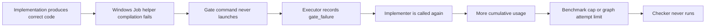

# Why the V1 benchmark runs fail

This analysis separates artifact correctness, root-turn completion, graph completion, and benchmark limits. It uses the preserved Luna attempts and a separately bounded Terra cohort at the same product runtime. The original Gemma skill-discovery and synchronous-transport problems belong to the test apparatus and are already described in [the benchmark report](v1-build-benchmark.md).

## The confirmed failure chain

The Windows shell path constructs and compiles a private Job Object helper before launching the requested command. A setup exception returns exit 125 with `termination_failed: true`, even when no test process has launched. The executor turns that into `termination_unverified`, classifies the attempt as `gate_failure`, and makes the node pending again while attempts remain. Its next attempt starts a fresh implementer session. The successful model output is retained, but there is no separate gate-only recovery in this path.

This is the wrong recovery target for a compiler/setup problem: another model turn cannot repair the host's helper build merely by rewriting a correct project artifact. The gate's refusal to approve an unverified execution remains appropriate. The problems are setup compatibility, missing diagnostics, failure classification, and retry routing—not evidence that the tests ran and rejected the code.

Relevant implementation: [helper compilation and setup](../src/shell.ts), [gate classification and retry](../src/executor.ts). The compiler's stdout is discarded while only stderr is retained. This loses diagnostics from compilers that report errors on stdout. The setup catch also conflates failure to establish containment with failure to terminate an already-running command.

The follow-up reproduction used the production selector's first existing candidate, `Framework64/v4.0.30319/csc.exe` (version 14.8.10001.0), with the exact 5,786-byte embedded source and an isolated environment without `ProgramFiles`. Source/output paths of 249/250 characters compiled successfully. At 291/292 characters, the same compiler exited 1 with `fatal error CS2021: File name ... is too long or invalid` on **stdout**, with empty stderr. Exactly two compiles ran and neither resulting program was executed. This reproduces both the long-path defect and the lost diagnostic using the selected backend, strengthening the earlier fallback-only reproduction. The original discarded stdout remains unrecoverable.

The selector checks fixed .NET locations, not PATH; `Get-Command csc` alone cannot qualify its availability. The earlier PowerShell fallback receipts remain unchanged. [Selector-matched reproduction](evidence/build-20261112/checks/selected-csc-path-repro-d709bde3-4a59-47b5-a0b0-0ab806561d7f.json).

## A different Terra failure: insufficient verification evidence

Terra's default coding plan omitted the optional shell-gate command. The shipped `coding-diamond` implementer uses a schema gate by default, so its first implementation passed without encountering the Windows helper. This is not evidence that Terra repaired or bypassed a configured gate. It chose a different plan through the same available interface.

The checker then inspected the source and accepted that the implementation expressed the requested count, interval and label behavior. It rejected the test-execution and preservation claims because the supplied output did not include the executed test output, independent assertions, or sufficient status evidence. Its `score: 6` / `passed: false` was a valid substantive rejection, followed by a feedback-routed implementation attempt. The benchmark's usage limit interrupted that attempt.

The default graph wires `claimed: implement` to the checker, without the optional selected-evidence inputs. The checker may read files but is explicitly forbidden to execute shell commands. Thus a successful schema check and a worker's statement that tests passed do not give it reliable evidence that those tests actually ran. A code-correctness pass in the external benchmark does not make this internal evidence gap disappear.

This identifies a separate design need: supply bounded, host-recorded verification receipts to the existing artifact/evidence path, including the command, working directory, exit outcome and relevant output, with run/node/attempt identity. For preservation criteria, capture the relevant pre-work basis instead of expecting the checker to reconstruct it from final files. Do not resolve the gap by treating a model-written success claim as a trusted execution receipt or weakening the checker.

The default implementer actually executed `npm test` and independent boundary/offset assertions. Those tool results were present in its session but not supplied to the checker. The missing link is between executed verification and the checker input. The checker correctly distinguished readable source behavior from unsupported execution/preservation claims.

Terra's targeted coding graph subsequently completed all four nodes on their first attempts, with a passing external artifact oracle. Its plan also omitted the shell gate, and its model-written criteria were not identical to the default plan: the default added an explicit hard requirement to run tests and verify boundaries, while targeted used broader verification wording. The targeted checker accepted the claimed verification after inspecting files. The frozen user request did not explicitly require a test execution log. Adding testing is a reasonable engineering step, but promoting it into a hard criterion without a matching evidence channel changes what the checker must prove. This is a criterion-provenance and evidence-delivery problem; the single differing verdict does not isolate the targeted mandate's effect.

## A second failure: stopping after planning

In Luna's default report trial, the requested phase was to write `preparation.md` and stop before writing the report. The agent loaded the skill, made a graph plan, then ended its turn explicitly saying preparation had not been created. That is an unmet deliverable, not a schema parse failure, compaction failure, or false claim that the file exists.

The plan response already said `status: planning` and `next: Call alg_run`. The shipped orchestrator's typical flow says plan then run, but its communication rule also allows reporting a run ID and only prohibits claiming unfinished work is done. There is no explicit instruction that an artifact request must proceed from a successful plan to execution before a final answer. The agent therefore ended honestly but prematurely; no host error, budget stop, or missing skill caused this trial's failure.

The smallest correction is to state in both role guidance and the plan response: if the user requested work, call `alg_run` after a successful live plan; stop at planning only for an explicitly plan-only or dry-run request. This remains model-followed guidance. A deterministic combined plan-and-execute action would require a separate action contract, retaining `alg_plan` for legitimate plan-only use. Neither approach should create an unbounded continuation loop.

## What the token stops actually mean

The benchmark enforces 200,000 cumulative reported token components across all assistant turns and child sessions. It counts cache-read components and is separate from the configured 128,000-token per-context limit. It is not an invoice-verified cost cap. Three Luna trials stopped at that usage threshold; the plugin itself did not report a 200,000-token context overflow.

The coding graphs also had a confirmed helper setup failure before their budget stop, so their cost is not a clean measurement of a functioning diamond. The targeted report trial produced a correct artifact after compaction/restart without using an ALG graph; it nevertheless crossed the same cumulative threshold before normal root completion. Increasing the limit might allow more work to finish, but it would not repair deterministic helper setup or establish efficiency.

Recomputed Luna coding usage, using the existing message-deduplicating collector:

| Session/attempt | Default ALG | Targeted ALG |
| --- | ---: | ---: |
| Primary agent | 17,929 | 57,315 |
| Explorer | 16,757 | 23,848 |
| Researcher | 26,108 | 30,219 |
| First implementer | 98,255 | 56,782 |
| Second implementer | 45,679 | 39,958 |
| Total reported components | 204,728 | 208,122 |

The second implementation attempts accounted for about 22.3% and 19.2% of those totals. Removing a futile retry addresses measured spend, but does not prove the remaining budget would suffice for a checker. Native Build used 58,491 reported components on this coding task. About 57–58% of the ALG totals were cache reads, so these ratios cannot be treated as dollar-cost ratios.

For the staged report, targeted Luna used 107,820 components initially, 8,656 during compaction and 94,505 during follow-up. Build used 68,459, 4,961 and 81,870 respectively. Targeted loaded the skill successfully; both approaches reread source files after compaction. Those reads are consistent with restoring current evidence. Repeated reads across fresh agents are not automatically wasted searches, and the saved telemetry cannot assign token cost to each read or isolate the exact prompt/tool-schema overhead.

The [attribution JSON](evidence/build-20261112/checks/luna-usage-attribution.json) is reproducible with `bun docs/evidence/build-20261112/checks/analyze-luna-usage.ts` from the repository root. Tool-call `completed` means the tool returned, not that the returned graph status was successful; graph status must come from durable run state.

## Reading the scores correctly

The frozen runner's `passed` flag means the independent artifact oracle passed and the requested root phases finished without a recorded budget/transport/model stop. It does **not** require an ALG run to have reached `done`. This deliberately avoids grading native Build against ALG-only contracts. For diagnosis, report these separately:

- Correct artifact and protected inputs.
- Within-budget root/phase completion.
- Whether a graph was planned and executed.
- Graph terminal status, child attempts, and whether a checker actually completed.
- Successful skill load and correct application after compaction/restart.

No targeted-review benefit can be inferred from a trial that never executes its checker. A stronger model also cannot be credited with fixing the Windows helper merely because its final code passes the independent oracle.

## Terra result and implications

The six-trial `openai/gpt-6.1-terra` cohort used the same runtime, fixtures, oracle and budgets. Native Build completed both tasks. Targeted ALG completed the full coding graph and passed the external code oracle, using 199,134 reported components versus Build's 42,123. Default ALG produced correct code but its evidence-repair attempt crossed the cap at 211,205.

Both ALG report arms completed a four-node preparation graph, including the checker, and recovered after compaction plus one restart. Each then hit the cumulative cap before `report.json` existed: default 202,811 components; targeted 201,534. Targeted had begun a separate phase-two graph when interrupted. This is authorized phase progression, not proof of redundant planning. Each ALG arm read the applicable `SKILL.md` directly once; neither used the skill tool. An empty skill-tool counter therefore does not mean the skill was never consulted.

Three Terra graphs reached `done`: coding/targeted and both preparation graphs. Two further graphs were blocked when the benchmark stopped. These internal completions are distinct from whole-task success: only one of the four ALG-configured trials completed the user deliverable within the frozen limits. Native Build was 2/2. See the [full measured table](v1-build-benchmark.md#terra-follow-up).

Across the six Luna/Terra coding trials, the independent code oracle passed every artifact. Failures centered on completing verification reliably: Windows setup and retry routing in Luna, evidence delivery and criterion differences in Terra, and cumulative usage limits. The report trials show additional orchestration/efficiency problems; they do not establish a general compaction or skill-loss defect.

## Model-agnostic repair order

1. **Make gate setup reliable and observable.** Capture bounded stdout/stderr and the chosen compiler identity; use a long-path-compatible private helper build route. Qualify it before costly graph execution. Retain containment and fail-closed behavior.
2. **Separate environment recovery from code repair.** Give setup failure a distinct outcome and block futile implementer reruns. Any gate-only resume must validate that the saved output, relevant files and gate identity still match; do not silently approve old work.
3. **Deliver evidence the checker can verify.** Reuse the existing artifact and selected-evidence channels for bounded host-origin test receipts and the relevant pre-work basis. Identify original requirements separately from model-derived verification methods. Freeze criteria for controlled checker comparisons.
4. **Close the plan-to-run handoff.** Clarify execution intent and preserve an explicit plan-only path. An honest plan is not the requested implementation or preparation artifact.
5. **Choose graph size for the task.** Measure usage and select the smallest workflow that supplies the needed independent checks. Avoid repeating a full exploration/research sequence for a small continuation when validated evidence can be reused. Do not special-case model names or treat a larger spending limit as a repair.

This change records diagnosis, reproducers and the bounded Terra experiment. It does not claim these product repairs are implemented. All tests/probes ran locally; no local Gemma inference, GitHub runners, V2 work, global configuration edits or merge occurred.
